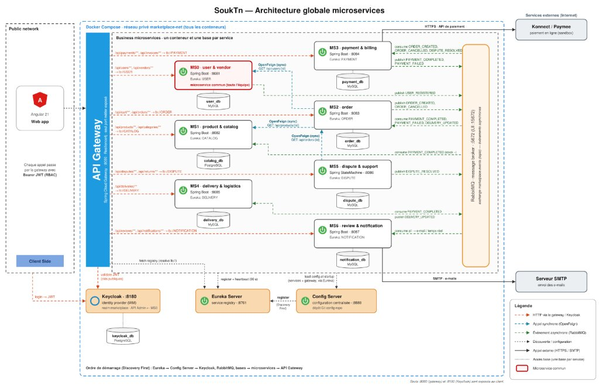

# SoukTn — 4SSA16 — Groupe 5

> **Marketplace e-commerce multi-vendeurs** tunisienne, évolutive et résiliente, basée sur une architecture en microservices.

---

## 📋 Problématique

Le retrait de Jumia du marché tunisien (fin 2024) a mis en lumière l'absence d'une alternative nationale robuste. Une plateforme monolithique souffrirait de :
- **Couplage fort** : la défaillance d'un module (ex. paiement) peut paralyser toute la plateforme.
- **Scalabilité limitée** : impossible d'allouer des ressources ciblées aux services les plus sollicités.
- **Complexité multi-vendeurs** : flux hétérogènes (stocks, livraisons, paiements, litiges) difficiles à faire évoluer dans un même code.
- **Rigidité des données** : un modèle unique doit stocker à la fois des données financières strictes et des fiches produits aux attributs variables.

**SoukTn** répond à ces problèmes avec 7 microservices autonomes, chacun propriétaire de sa base de données.

---

## 👥 Acteurs

| Acteur | Rôle |
|--------|------|
| **Visiteur** | Consulte le catalogue, recherche des produits, remplit un panier, s'inscrit |
| **Client** | Passe et paie ses commandes, suit ses livraisons, consulte ses factures, laisse des avis, ouvre des litiges |
| **Vendeur** | Gère sa boutique, ses produits et ses stocks, consulte ses commandes reçues, répond aux litiges |
| **Livreur** | Consulte ses livraisons assignées et met à jour leur statut |
| **Administrateur** | Gère les utilisateurs, valide les vendeurs, gère les catégories, assigne les livraisons, traite les litiges |

Acteurs secondaires (systèmes) : **Keycloak**, **passerelle de paiement** (Konnect / Paymee sandbox), **serveur e-mail (SMTP)**.

---

## ✨ Principales fonctionnalités

- 🔐 **Comptes & autorisations** : authentification déléguée à Keycloak (OpenID Connect, JWT), rôles CLIENT / VENDOR / ADMIN / DELIVERY.
- 🛍️ **Catalogue multi-vendeurs** : produits, catégories, stocks, recherche plein texte.
- 🛒 **Panier & commandes** : panier, commande, suivi (En attente → Confirmée → Expédiée → Livrée ; annulation possible uniquement avant paiement).
- 💳 **Paiement & facturation** : Konnect / Paymee en sandbox + simulation (mock), factures PDF, remboursements.
- 🚚 **Livraison** : assignation des livreurs, suivi des étapes.
- ⚖️ **Litiges & retours** : cycle de vie géré par Spring StateMachine.
- 🔔 **Avis & notifications** : avis sur produits achetés et livrés, notifications e-mail et dans l'application.

---

## 🏗️ Architecture globale



### Composants d'infrastructure

| Composant | Technologie | Port | Rôle |
|-----------|-------------|------|------|
| **API Gateway** | Spring Cloud Gateway | 8080 | Point d'entrée unique, validation du JWT, routage `lb://`, CORS |
| **Discovery Server** | Spring Cloud Netflix Eureka | 8761 | Enregistrement et localisation des microservices |
| **Config Server** | Spring Cloud Config | 8888 | Configuration centralisée (dossier `config-repo`), mode Discovery First |
| **Keycloak** | Keycloak (realm `marketplace`) | 8180 | Identités, connexion OIDC, émission des JWT, rôles |
| **RabbitMQ** | RabbitMQ (exchange `marketplace.events`, type topic) | 5672 / 15672 | Communication asynchrone par événements |

### Communications
- **Synchrone** (REST / OpenFeign + Resilience4j) : uniquement quand la réponse est nécessaire pour continuer — Order → User, Order → Catalog, Dispute → Order.
- **Asynchrone** (RabbitMQ) : 7 événements — `USER_REGISTERED`, `ORDER_CREATED`, `ORDER_CANCELLED`, `PAYMENT_COMPLETED`, `PAYMENT_FAILED`, `DELIVERY_UPDATED`, `DISPUTE_RESOLVED`. Files durables, consommateurs idempotents (`eventId`), DLQ après 3 échecs.

---

## 🧩 Microservices

| # | Service | Port | Responsable | Base de données | Responsabilités | Infra |
|---|---------|------|-------------|-----------------|-----------------|-------|
| 0 | **User Service** (FastAPI) | 8081 | *Toute l'équipe* | MySQL `microservice` | Création publique et gestion des profils utilisateurs | Eureka ; Keycloak pour les opérations protégées |
| 1 | **Product & Catalog Service** | 8082 | Hendez Badii | PostgreSQL `catalog_db` | Catalogue, catégories, stocks, recherche (JSONB, plein texte) | Discovery Server |
| 2 | **Order Service** | 8083 | Ben Azzoun Myriam | MySQL `order_db` | Panier, commandes, suivi | API Gateway |
| 3 | **Payment & Billing Service** | 8084 | Nouaigui Marouen | MySQL `payment_db` | Paiement sandbox (Konnect / Paymee) + mock, factures, remboursements | RabbitMQ + Config Server |
| 4 | **Delivery & Logistics Service** | 8085 | Jdidi Aziz | MySQL `delivery_db` | Assignation des livreurs, suivi des expéditions | Docker Compose |
| 5 | **Dispute & Support Service** | 8086 | Zerzeri Yasmine | MySQL `dispute_db` | Litiges, retours, Spring StateMachine | Support architecture |
| 6 | **Review & Notification Service** | 8087 | Ben Maghzouz Ahmed | MySQL `notification_db` | Avis produits, notifications e-mail et in-app | Base Frontend Angular |

Dans l'architecture cible, Keycloak utilise PostgreSQL `keycloak_db` et chaque
microservice possède sa base. Dans ce checkout, le User Service FastAPI utilise
actuellement `microservice`, y compris la table `user_profiles` existante.

---

## 🛠️ Stack technique

| Couche | Technologies |
|--------|-------------|
| **Backend** | Python 3.12 / FastAPI (User Service), Java 21 / Spring Boot 4.x, Spring Cloud (Eureka, Config), Spring Data JPA |
| **Frontend** | Angular 21, Bootstrap, Angular Material, keycloak-angular |
| **Bases de données** | MySQL (6 services), PostgreSQL (catalogue, Keycloak) |
| **Messaging** | RabbitMQ |
| **Sécurité** | Keycloak, OAuth2 / OpenID Connect, JWT |
| **Résilience** | Resilience4j (timeout, retry, circuit breaker) |
| **Conteneurisation** | Docker, Docker Compose |
| **API Docs** | Swagger / OpenAPI (springdoc) |

---

## 📁 Structure du dépôt

```
SoukTn-4ssa16-g5/
├── Backend/
│   ├── api-gateway/
│   ├── discovery-server/
│   ├── config-server/
│   ├── config-repo/          # fichiers YAML lus par le Config Server
│   ├── user-service/
│   ├── catalog-service/
│   ├── order-service/
│   ├── payment-service/
│   ├── delivery-service/
│   ├── dispute-service/
│   └── notification-service/
├── Frontend/
│   └── ecommerce-web-app/
├── Documentation/
│   ├── Presentation/
│   └── Diagrams/
├── docker-compose.yml
└── README.md
```

### Conventions
- Versions : Java 21, Spring Boot 4.2.0 (Spring Cloud 2026.0.0), Maven, configuration en YAML (`application.yml`)
- `groupId` : `tn.souktn` — package : `tn.souktn.<service>`
- `spring.application.name` : `user`, `catalog`, `order`, `payment`, `delivery`, `dispute`, `notification` (correspond aux routes `lb://USER`, `lb://CATALOG`… de la Gateway)
- Ordre de démarrage : Discovery Server → Config Server → Keycloak / RabbitMQ / bases → microservices → Gateway

## ▶️ Run the services in this checkout (Windows PowerShell)

Open one PowerShell terminal per service and leave each running. These commands
are for the modules present in this checkout: Eureka, Config Server, the Python
FastAPI User Service, and optionally the Delivery Service. The `Frontend`
directory currently has no app manifest, so there is no frontend start command
in this checkout.

### 1. Start the prerequisites

- Start your local MySQL server first. The User Service defaults to
  `localhost:3306` and the existing `microservice` database.
- Java 21 is required by the backend parent build. Check it with
  `java -version`.
- The public `POST /api/users` endpoint does not require Keycloak. Keycloak is
  needed only for protected user read/update/delete operations.

### 2. Start Eureka

From the repository root, in a new terminal:

```powershell
Set-Location .\Backend\eurekaServer
.\mvnw.cmd spring-boot:run
```

Eureka dashboard: `http://localhost:8761`

### 3. Start Config Server

In another terminal:

```powershell
Set-Location .\Backend\config-server
.\mvnw.cmd spring-boot:run
```

Config Server: `http://localhost:8888`

### 4. Configure and start the FastAPI User Service

In another terminal:

```powershell
Set-Location .\Backend\user-service
python -m venv .venv
.\.venv\Scripts\Activate.ps1
python -m pip install -r requirements.txt
if (-not (Test-Path .env)) { Copy-Item .env.example .env }
notepad .env
```

In `.env`, set `DB_PASSWORD` to your MySQL password if it is not blank. Keep
`DB_NAME=microservice` to store profiles in the database shown in phpMyAdmin.
Save the file, then run in that same terminal:

```powershell
uvicorn app.main:app --host 0.0.0.0 --port 8081
```

The service creates the database/table if missing (the MySQL account must have
permission to create databases). It registers as `USER` in Eureka when Eureka
is running.

- Swagger: `http://localhost:8081/docs`
- Health: `http://localhost:8081/actuator/health`
- Create a profile without Keycloak: use `POST /api/users` in Swagger.
- Profiles are stored in `microservice.user_profiles`. The existing table uses
  the legacy `keycloak_id` column for the FastAPI-generated profile UUID.

### Run the User Service tests

With the User Service virtual environment active:

```powershell
python -m pytest
```

### 5. Optional: start the Delivery Service

The Delivery Service also needs MySQL. In a separate terminal, set the database
password before starting it:

```powershell
Set-Location .\Backend
$env:DB_PASSWORD = "your-mysql-password"
.\config-server\mvnw.cmd -f .\delivery-service\pom.xml spring-boot:run
```

It uses port `8085` and registers with Eureka. If your MySQL root password is
blank, set `$env:DB_PASSWORD = ""` instead. This environment variable applies
only to that PowerShell terminal.

### Stop the services

In each service terminal, press `Ctrl+C`. If the service is running in the
background, stop only its own terminal/process; do not terminate unrelated
Java, Python, or MySQL processes.

> The architecture and service list above describe the broader target platform.
> This checkout does not currently contain the Angular app, API Gateway,
> Keycloak configuration, or all seven microservices; those components need
> their own setup before the full platform can be launched.

---

## ➕ Ajouter un service au backend

Toutes les versions sont imposées par le POM parent `Backend/pom.xml` (`tn.souktn:souktn-backend`). Un service ne déclare **aucune** version.

1. `git checkout main && git pull`, puis `git checkout -b feature/<service>`.
2. Générer le projet dans `Backend/` (IntelliJ ou start.spring.io) : Maven, Java 21, Spring Boot 4.2.0, configuration YAML, group `tn.souktn`, package `tn.souktn.<service>`, sans créer de dépôt Git.
3. Dans `Backend/<service>/pom.xml`, remplacer le bloc `<parent>` par le bloc ci-dessous, puis supprimer `<groupId>`, `<version>`, `<properties>` et `<dependencyManagement>`. Les dépendances restent **sans version**.

   ```xml
   <parent>
       <groupId>tn.souktn</groupId>
       <artifactId>souktn-backend</artifactId>
       <version>1.0.0-SNAPSHOT</version>
       <relativePath>../pom.xml</relativePath>
   </parent>
   ```

4. Ajouter `<module>nom-du-dossier</module>` dans la section `<modules>` de `Backend/pom.xml`.
5. Vérifier depuis `Backend/` : `mvn clean package -DskipTests` doit afficher `SUCCESS` pour tous les modules.

Exemple de référence : `Backend/config-server/pom.xml`.

### Checklist du relecteur (PR d'un nouveau service)
- [ ] Le `<parent>` est `souktn-backend`
- [ ] Aucune version de Spring Boot, Spring Cloud ou Java dans le `pom.xml` du service
- [ ] Le module est ajouté dans `Backend/pom.xml`
- [ ] `mvn clean package -DskipTests` réussit depuis `Backend/`
- [ ] `spring.application.name` respecte la convention

---

## 🌿 Gitflow

| Branche | Rôle |
|---------|------|
| `main` | Version stable, prête à la démo |
| `develop` | Branche d'intégration |
| `feature/<service>` | Développement par microservice (ex. `feature/catalog-service`) |
| `docs/<sujet>` | Documentation |

Chaque branche est fusionnée par Pull Request relue par un autre membre. Commits au format Conventional Commits (`feat:`, `fix:`, `docs:`, `chore:`).

---

## 🗓️ Planning (sprints)

| Sprint | Thème | Contenu |
|--------|-------|---------|
| **Sprint 1** | Conception | Besoins, architecture, diagrammes UML, contrats d'API, squelettes des microservices |
| **Sprint 2** | Socle & CRUD | API REST de base, Discovery Server, Config Server, API Gateway, Docker Compose des bases |
| **Sprint 3** | Communications & logique avancée | OpenFeign, RabbitMQ, Spring StateMachine, paiement sandbox, sécurité Keycloak, intégration Angular |
| **Sprint 4** | Tests & livraison | Tests d'intégration, conteneurisation complète, recette |

---

## ⚠️ Gestion des risques

| Risque | Impact | Mitigation |
|--------|--------|-----------|
| Incohérence des API inter-services | 🔴 Élevé | Contrats d'API stricts via Swagger / OpenAPI |
| Panne d'un microservice | 🔴 Élevé | Resilience4j (timeout, retry, circuit breaker) sur les appels OpenFeign |
| Perte ou doublon d'événements | 🟡 Moyen | Files durables, consommateurs idempotents (`eventId`), DLQ |
| Sandbox de paiement indisponible | 🟡 Moyen | Simulation interne (mock) derrière la même interface |
| Retard d'intégration du frontend | 🟡 Moyen | Mocks et Swagger pour une consommation anticipée |

---

## 📂 Documentation

- `Documentation/` : documentation technique du projet
- `Documentation/Diagrams/` : diagramme d'architecture globale et diagrammes UML
- `Documentation/Presentation/` : supports de présentation
