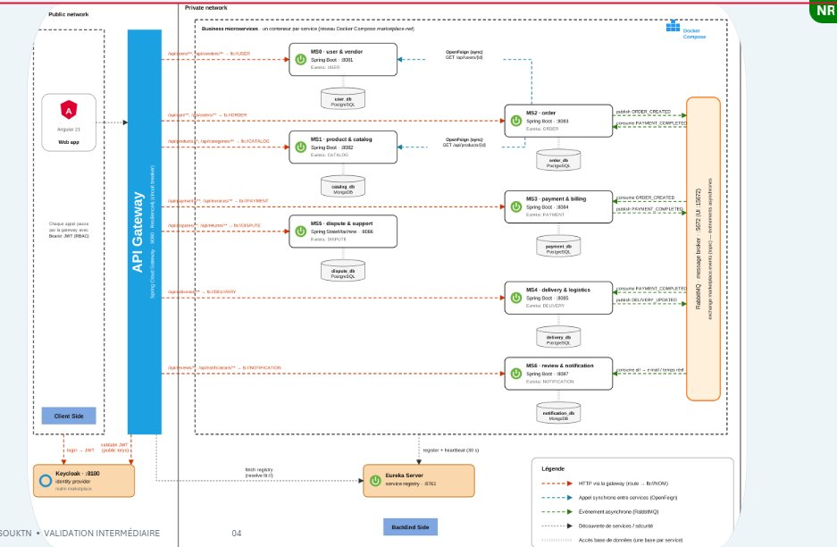

# SoukTn — 4SSA16 — Groupe 5

> **Marketplace E-Commerce Multi-Vendeurs** tunisienne, moderne, évolutive et résiliente, basée sur une architecture distribuée en microservices.

---

## 📋 Problématique

Le retrait de Jumia du marché tunisien a mis en lumière l'absence d'une alternative nationale robuste. Les solutions existantes souffrent de :
- **Couplage fort** : la défaillance d'un module peut paralyser toute la plateforme.
- **Scalabilité limitée** : impossible d'allouer des ressources ciblées aux services surchargés.
- **Complexité multi-vendeurs** : gestion difficile des flux hétérogènes (stocks, livraisons, commissions).
- **Rigidité des données** : impossible de combiner données financières strictes et catalogues NoSQL flexibles.

**SoukTn** répond à ces problèmes via une architecture microservices autonome, hautement disponible et adaptée au marché tunisien.

---

## 👥 Acteurs

| Acteur | Rôle |
|--------|------|
| **Client (Acheteur)** | Parcourt le catalogue, gère son panier, passe des commandes, effectue des paiements, suit ses livraisons, laisse des avis |
| **Vendeur (Marchand)** | Gère sa boutique, publie ses produits, gère ses stocks et consulte les commandes |
| **Livreur** | Reçoit les ordres d'expédition, met à jour le statut d'acheminement |
| **Administrateur** | Modère la plateforme, valide les comptes vendeurs, supervise l'activité globale |

---

## ✨ Principales Fonctionnalités

- 🔐 **Gestion des comptes & autorisations** : Inscription, connexion sécurisée JWT, contrôle d'accès basé sur les rôles (RBAC).
- 🛍️ **Catalogue multi-marchands** : CRUD produits, gestion des catégories, des stocks et recherche fluide.
- 🛒 **Tunnel d'achat & Commandes** : Panier, validation de commande, suivi d'état (Créée → Payée → Expédiée → Livrée → Annulée).
- 💳 **Paiement sécurisé** : Intégration Sandbox (Konnect / Paymee) + simulation Mock, émission de factures.
- 🚚 **Logistique & Expédition** : Attribution des livraisons aux livreurs, suivi des étapes de transport.
- 🔔 **Notifications & Feedback** : Alertes asynchrones, système de notation et avis par produit.

---

## 🏗️ Architecture Globale

L'architecture adopte un modèle **distribué réactif** :



### Composants clés

| Composant | Technologie | Rôle |
|-----------|------------|------|
| **API Gateway** | Spring Cloud Gateway | Point d'entrée unique, routage, filtrage, load balancing |
| **Service Discovery** | Spring Cloud Eureka | Enregistrement dynamique et localisation des microservices |
| **Sécurité centralisée** | Keycloak + Spring Security JWT | Gestion des identités, Bearer Token, RBAC |
| **Comm. synchrone** | REST / OpenFeign | Échanges directs à réponse immédiate |
| **Comm. asynchrone** | RabbitMQ / Apache Kafka | Découplage des événements métier (ex: `ORDER_CREATED`) |
| **Résilience** | Resilience4j (Circuit Breaker) | Mode dégradé (Fallback) en cas de panne |

---

## 🧩 Microservices

| # | Service | Responsable | Base de données | Responsabilités |
|---|---------|-------------|-----------------|-----------------|
| — | **Auth & User/Vendor Service** | *Toute l'équipe* | PostgreSQL + Keycloak | Authentification, JWT, RBAC, profils utilisateurs et vendeurs |
| 1 | **Product & Catalog Service** | Hendez Badii | Postgresql | Catalogue, catégories, stocks, recherche produits + Eureka Server |
| 2 | **Order Service** | Ben Azzoun Myriam | MYSQL | Panier, création et suivi des commandes + API Gateway |
| 3 | **Payment & Billing Service** | Nouaigui Marouen | MYSQL | Paiement Sandbox (Konnect/Paymee), facturation + RabbitMQ/Kafka |
| 4 | **Delivery & Logistics Service** | Jdidi Aziz | MYSQL | Assignation livreurs, suivi expéditions + Docker Compose |
| 5 | **Dispute & Customer Support** | Zerzeri Yasmine | MYSQL | Litiges, réclamations, retours (RMA) via Spring StateMachine |
| 6 | **Review & Notification Service** | Ben Maghzouz Ahmed | Mysql | Avis/notes produits, notifications asynchrones + coord. Frontend Angular |

---

## 🛠️ Stack Technique

| Couche | Technologies |
|--------|-------------|
| **Backend** | Java 21, Spring Boot 3.x, Spring Cloud (Gateway, Eureka, OpenFeign), Spring Data JPA, Spring Security |
| **Frontend** | Angular 21, Bootstrap, Angular Material |
| **Bases de données** | MySQL / PostgreSQL (relationnel), MongoDB (NoSQL) |
| **Messaging** | RabbitMQ / Apache Kafka |
| **Sécurité** | Keycloak, JWT, Resilience4j (Circuit Breaker) |
| **Conteneurisation** | Docker, Docker Compose |
| **API Docs** | Swagger / OpenAPI |

---

## 📁 Structure du Dépôt

```
SoukTn-4ssa16-g5/
├── Backend/
│   ├── api-gateway/
│   ├── discovery-server/
│   ├── user-service/
│   ├── catalog-service/
│   ├── order-service/
│   ├── payment-service/
│   ├── delivery-service/
│   ├── notification-service/
│   └── dispute-service/
├── Frontend/
│   └── ecommerce-web-app/
├── Documentation/
│   ├── Presentation/
│   │   └── Seance4_Presentation.pdf
│   └── Diagrams/
│       ├── Architecture_Globale.png
│       └── Class_Diagrams/
├── docker-compose.yml
└── README.md
```

---

## 🌿 Gitflow

| Branche | Rôle |
|---------|------|
| `main` | Version stable, prête à la démo |
| `develop` | Branche d'intégration continue |
| `feature/<service>` | Développement par microservice (ex: `feature/catalog-service`) |

---

## 🗓️ Planning (Sprints)

| Sprint | Thème | Contenu |
|--------|-------|---------|
| **Sprint 1** | Conception | Analyse des besoins, architecture, diagrammes UML, squelettes des microservices |
| **Sprint 2** | CRUDs Métiers | API REST de base, Eureka, API Gateway, Docker Compose BDD |
| **Sprint 3** | Avancé & Communication | Spring StateMachine, paiement Sandbox, OpenFeign, RabbitMQ, intégration Angular |
| **Sprint 4** | Tests & Recette | Tests d'intégration, montée en charge, sécurité Keycloak, conteneurisation finale |

---

## ⚠️ Gestion des Risques

| Risque | Impact | Mitigation |
|--------|--------|-----------|
| Incohérence des API inter-services | 🔴 Élevé | Contrats d'API stricts via Swagger/OpenAPI |
| Panne d'un microservice | 🔴 Élevé | Circuit Breaker Resilience4j à l'API Gateway |
| Communication asynchrone complexe | 🟡 Moyen | POC RabbitMQ en phase initiale |
| Retard intégration Frontend | 🟡 Moyen | Mocks & Swagger pour consommation anticipée |

---

## 🔗 Liens

- 📄 [Documentation technique](Documentation/)
- 🖼️ [Diagrammes](Documentation/Diagrams/)
- 🎤 [Présentation Séance 4](Documentation/Presentation/)
- 📌 Tableau Kanban : *(Trello / Jira — lien à compléter)*
- 📖 API Docs (Swagger) : *(lien à compléter)*
